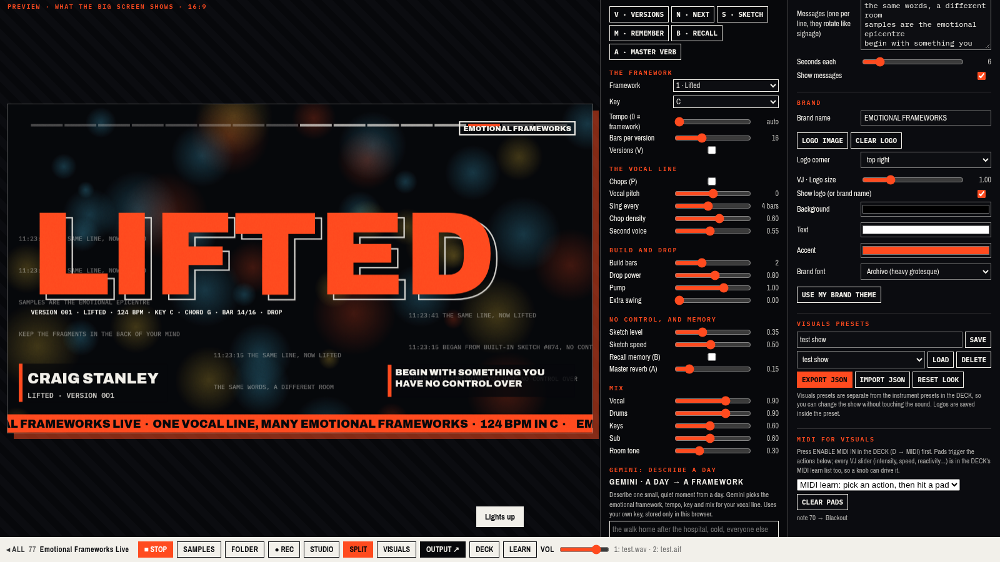

# Emotional Frameworks Live

**One vocal line, seven emotional frameworks, and a big screen behind you.**

**Play it:** https://emotional-frameworks-live.netlify.app

This is the stand-alone, performance version of machine 77 in [Manifesto Machines](https://github.com/anorthernman-developer/manifesto-machines) ([original tool](https://anorthernman-developer.github.io/manifesto-machines/tools/77-emotional-frameworks.html)). The idea is found-sound production with one vocal line in many emotional frameworks: the same words, in a different room, become a different feeling. The look is layered, type-as-image night graphics.

Everything the original does is still here. On top of that there is a **VJ / digital signage output** that reacts to the audio: you play the instrument on your laptop while the projector shows the visuals.

## What is in it

**The instrument (from tool 77, all kept)**
- Seven frameworks: Lifted, Two-step, Numb, Panic in the Club, Gospel, The Rave (New York) and Meditative (Secret). Use keys 1 to 7, or MIDI notes 36 to 42.
- Your own samples: WAV, AIFF or MP3, one at a time or a whole folder. Use SAMPLES or FOLDER, or drag and drop onto the page.
- Each slot has pitch, gain, filter, pan, reverb, delay, reverse and mute, plus **START and END trim**. The trim now has a waveform with **draggable START and END handles**. Drag the nearest handle, shift-drag to move the whole region, double-click to reset. The slot plays back with a moving playhead, and the readouts are in seconds.
- Presets are saved in your browser, and you can export and import them as JSON. Web MIDI with MIDI learn, a WAV recorder, the limiter, keyboard shortcuts and the LEARN panel are all still there.
- Gemini "describe a day" turns a sentence into a framework. It uses **your own key**, which you paste into the page. Your key stays in your browser: it is only kept in this browser's `localStorage` (`sr12.geminiKey`), sent only to Google (`generativelanguage.googleapis.com`) with your requests, and never committed or sent to us. FORGET KEY deletes it.

**Live visuals (new)**
- **Eight scenes:** Overprint, Skyline, Swiss Grid, Particle Bloom, Sample Scope, Signage Board, Bauhaus Radial and Kinetic Type. Sample Scope shows your vocal sample with its START/END region, chops and playhead, live.
- **Auto-cycle** through the scenes by timer, every N bars, on each section change (intro, build, drop, break) or on each new version. Choose which scenes are included and how they change: fade, wipe, flash or cut.
- **Themes** are design styles: Night overprint, Swiss grid, Bauhaus geometry, Acid techno graphics, Minimal black, Condensed red and black, Cut-paper titles, New-wave pastel and Grunge layout. There is also **Your brand**. "Framework moods" can switch the theme to match the framework you are playing.
- **Text layers:** a headline, artist and track lower third, a scrolling ticker and rotating messages for signage. They support live tokens: `{framework} {word} {bpm} {key} {chord} {section} {version} {bar} {bars} {time} {date} {artist} {brand} {sample}`.
- **Brand:** name, logo upload (PNG/SVG/JPG), logo corner and size, background, text and accent colours, and font.
- **Live sliders:** intensity, speed, audio reactivity, trails, drop flash, glitch, grain and text size. Every slider can be MIDI-learned in the DECK.
- **BLACKOUT** (K) and **FREEZE** (F) for the moments between tracks.
- **Visuals presets** are separate from the sound presets. There are seven factory looks, and you can save, load, delete, and export or import JSON.
- **MIDI pads for visuals:** pick an action (scene 1 to 8, next, previous, blackout, freeze, cycle, theme, message), then hit a pad.

## Three layouts

| Layout | What you see | Key |
|---|---|---|
| **SPLIT** (default) | Live 16:9 preview on the left, instrument and visuals controls on the right | G cycles the layouts |
| **STUDIO** | The original instrument, full size | G |
| **VISUALS** | Visuals only, full window (for a single-screen setup or a second browser) | G, Esc to go back |

**OUTPUT ↗** (or O) opens a separate output window with no controls in it. That is the window for the projector. Open several if you have several screens.

## Live setup: laptop and projector

1. Plug the projector or big screen into the laptop.
2. In your display settings, choose **Extend** rather than Mirror. On a Mac that is System Settings → Displays, with Mirror turned off. On Windows press Win+P → Extend.
3. Open the app in **Chrome or Edge** on the laptop and press **▶ PLAY** once. Browsers only start audio after a click.
4. Press **OUTPUT ↗**. A new window opens. If the browser supports window placement, **TO PROJECTOR** moves it to the second screen for you. If not, drag it onto the projector.
5. **Click the output window**, or press **F**, to make it full screen. F11 (Ctrl+Cmd+F on a Mac) also works. The cursor hides after two seconds.
6. Go back to the laptop window. The status says `OUTPUT: 1 window connected`. Everything you change there (scene, theme, text, brand, blackout) appears on the big screen straight away, and the visuals follow the audio.

Tips
- If the output window ever says it lost the controller, the controller tab was closed or reloaded. Reopen it and press OUTPUT again, or just keep the output window open: on the Netlify site it reconnects on its own when the controller comes back.
- If audio goes to the projector over HDMI and you would rather keep it on your interface, choose the output device in your OS sound settings.
- Do a sound check in **SPLIT** first, then switch to **STUDIO** during the set if you want more room for the instrument. The output keeps running either way.
- You can also run it offline by opening `index.html` straight from disk (`file://`). The output window still syncs through the window that opened it. Google Fonts need the internet. Without it the browser falls back to system fonts.

## Keys

| Key | Action |
|---|---|
| 1–7 | Framework |
| Shift+1–8 | Visuals scene |
| [ and ] | Previous / next scene |
| C | Auto-cycle on/off |
| T | Next theme |
| J | Next message |
| K | Blackout |
| F | Freeze (in the output window F means full screen) |
| O | Open an output window |
| G | Change layout |
| Esc | Leave visuals-only |
| V, N, S, M, B, A, P | Instrument (versions, next, sketch, remember, recall, master verb, phrase/chops) |
| D | The DECK (sounds, presets, MIDI, keys) |
| Space | Play / stop |
| R | Record to WAV |
| L | LEARN panel |

## How it works

This is a static site with no build step, no server and no secrets. Plain `<script>` files run in order, so it also works from `file://`:

- `js/meta.js`: names, credits and LEARN text
- `js/mm-kit.js`: audio engine, limiter, recorder, MIDI and Gemini (Manifesto Machines kit)
- `js/mmx-deck.js`: sample slots, waveform handles, presets and MIDI learn
- `js/frameworks.js`: the instrument (tool 77). It also posts beat events (bar, drop, vocal, kick, clap, hat) for the visuals.
- `js/vj-engine.js`: the scenes, themes, overlays and transitions. The same renderer runs in the preview and in the output window.
- `js/live.js`: the controller. It holds the analyser on the master bus, the layouts, the visuals panel, presets, MIDI pads and sync.
- `output.html` + `js/output.js`: the projector window

The controller sends about 60 small frames a second (spectrum, levels, bar, section, beat counters). It sends them over `BroadcastChannel('efl-live')` and also by `postMessage` to the windows it opened. Each output window renders the frames by itself, so the projector runs at full frame rate and full resolution.

## Tests

`test/run.js` drives headless Chrome (Playwright). It checks the audio level, the analyser, opening the output window and sync of scene, text, theme, blackout, freeze and the START/END region. It also renders all eight scenes, tests auto-cycle, the WAV and AIFF slots, dragging the waveform handles, instrument presets, visuals preset save, load, export and import, and visuals MIDI learn with a simulated note. The run fails on any console error. Install `playwright-core` (`npm i playwright-core`) and point `CHROME` at Chrome if it is not at `/usr/bin/google-chrome`. Then run it over http (`python3 -m http.server 8099` and `node test/run.js http`) or with `node test/run.js file`, or against the live site with `node test/run.js https://emotional-frameworks-live.netlify.app`.

## Credits

Machine 77 of [Manifesto Machines](https://github.com/anorthernman-developer/manifesto-machines) by Craig Stanley. Inspired by the "emotional frameworks" idea described by the producer Fred again.. in interviews; the themes are design styles inspired by the movements and studios credited in the LEARN panel. These are not endorsements or affiliations, and no recordings, artwork or lyrics by anyone else are used. MIT licence. See [CREDITS.md](CREDITS.md) and [PRIVACY.md](PRIVACY.md).
